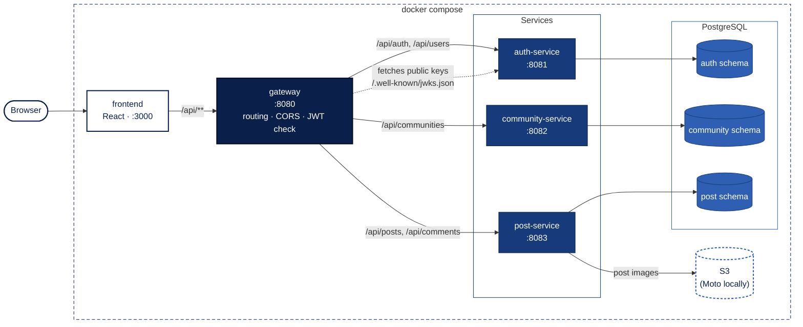
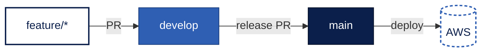

# levddit

<p align="center">
  
  
  
  
  
  
  
  
  
  
  
  
  
  
</p>

A small Reddit-style app built during the Levi9 Product & Cloud Engineering internship (2026).
Users can register, join communities, write posts with images, comment and vote.

## How it fits together



- **Gateway** is the only backend entry point. It routes by path and checks the JWT signature
  against the auth service's public keys (JWKS). Each service still decides who may do what on
  its own routes.
- **auth-service** handles users, roles and refresh tokens, and signs the JWTs.
- **community-service** handles communities and memberships.
- **post-service** handles posts, comments and votes, and stores post images in S3.
- **Each service owns its own schema.** When data belongs to another service, it is stored
  only as an ID. No cross-schema joins.

| Service | Schema | Models |
| --- | --- | --- |
| Auth | `auth` | Users, refresh tokens |
| Community | `community` | Communities, memberships |
| Post | `post` | Posts, images, comments, post votes, comment votes |

Flyway applies each service's migrations on startup, and Hibernate validates the JPA mappings.
Each service uses the usual Spring layout: `controller`, `service`, `repository`, `entity`, `dto`,
`exception`, `config` and `security`. The gateway only has `controller` and `security`.

Memberships and votes use a composite key made up of the target ID and user ID. When a feature
changes a membership or vote and updates a stored count or score, write both within the same
service transaction.

## Branches



`develop` is where work comes together, and `main` is what gets deployed. There is no staging environment.

## Status

| Area | State |
| --- | --- |
| Database schemas + migrations | done |
| Gateway routing, CORS, JWT verification | done |
| Auth: JWKS endpoint, delete user | done |
| Auth: register / login / refresh | in progress |
| Communities CRUD | in progress |
| Posts, comments, votes | in progress |
| AWS deployment | in progress: network, security groups, RDS |

## Run it locally

Requires Docker. For the backend checks without Docker Compose, you need Java 25.

```bash
docker compose up --build
```

| What | Where |
| --- | --- |
| Frontend | http://localhost:3000 |
| Gateway | http://localhost:8080 |
| PostgreSQL | localhost:5432 |

Run the backend tests with `./mvnw verify`. The tests use Testcontainers against a real Postgres,
so Docker must be running.

### Coverage

After a successful build, open `coverage-report/target/site/jacoco-aggregate/index.html` for
combined backend coverage, with a breakdown per service. Each service still has to meet its own
70% line coverage. `coverage-status.html` next to it shows each service's verification result and
line coverage; missing execution data is marked unavailable rather than counted as 0%, and
coverage from a failed verification is labeled potentially partial.

CI runs all services with `--fail-at-end` and builds the coverage report even when verification
fails (failures still fail CI). The status table is in the GitHub run summary, and the
`maven-reports` artifact holds the combined report and `maven-verify.log`.

## Notes

- The community list is `GET /api/communities?sort=new|top&name=&page=&size=`. It returns active
  communities with only their name and member count; the default order is `new`. Admins list
  shut-down communities with `?inactive=true`: the *presence* of the parameter selects the admin
  handler, so `inactive=false` still requires ADMIN. The frontend's searchable directory is
  `/communities`.
- `GET /api/communities/{name}` returns active community details publicly. Admins also receive
  inactive community details; the response includes `active` so the UI can show the shutdown state.
  Unknown names return 404 for everyone.
- `sort=hot` is in the endpoints document but not implemented yet. It needs activity data from
  post-service's `/internal/posts/community-activity`, which is separate work.

## Docs

- [Database diagram](docs/Base.mermaid)
- [Error convention](docs/error-convention.md)
- [Security convention](docs/security-convention.md)
- [Production changes](docs/production-changes.md)
- [Task spec (PDF)](docs/Zadatak-Levi9-Reddit-Praksa.pdf)
- [API endpoints (PDF)](docs/levddit-api-endpoints.pdf)
